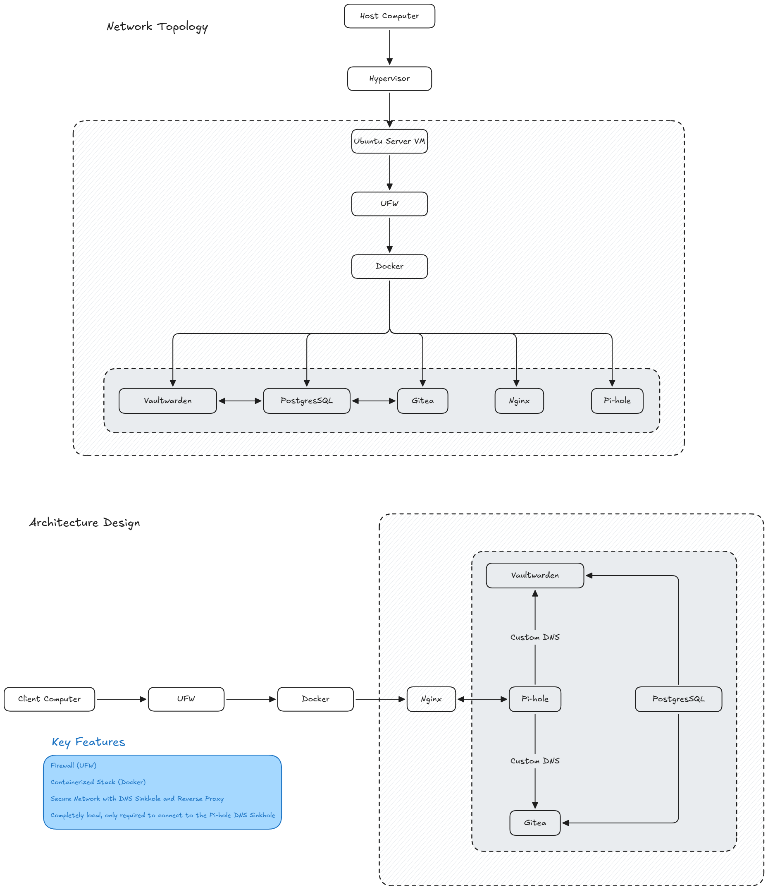

# Mission 10: The Enterprise Cloud Architect

## Project Overview

This project represents the final activity for CCM101 – Cloud Computing. It demonstrates the process of designing, configuring, deploying, securing, automating, and documenting a multi-tier application hosted on an Ubuntu Server virtual machine.

The infrastructure uses Docker and Docker Compose to organize and manage multiple interconnected application services. It also includes persistent database storage to protect important information and ensure that data remains available even after the virtual machine is restarted.

To strengthen server security, UFW (Uncomplicated Firewall) is configured to manage and restrict incoming network connections. Furthermore, a Bash script is created and scheduled using Cron to automate regular administrative operations, including database backups and system health checks.

This project combines the knowledge and practical experience gained from the previous Cloud Computing laboratory activities into one complete infrastructure deployment.

## Project Objectives

- Design and document the cloud infrastructure and network architecture.
- Install and configure an Ubuntu Server virtual machine.
- Set up Docker and Docker Compose.
- Deploy a multi-tier application using at least two connected containers.
- Configure persistent storage to retain database information.
- Secure the server using UFW with a default-deny incoming policy.
- Allow only the required network ports for application access and SSH connections.
- Create an executable Bash script for automating system operations.
- Configure Cron to execute scheduled administrative tasks.
- Develop technical documentation covering deployment, security, maintenance, and recovery procedures.

## Technology Stack

The table below outlines the tools, platforms, and configurations utilized in the project. Modify the entries according to the actual environment used during implementation.

| Component | Technology / Configuration |
|---|---|
| Host Machine | [Windows / Linux / macOS] |
| Hypervisor | [VirtualBox / VMware / Other] |
| Virtual Machine OS | Ubuntu Server [Version] |
| Container Platform | Docker |
| Container Orchestration | Docker Compose |
| Application | [WordPress / Nextcloud / Other] |
| Database | [MySQL / MariaDB / PostgreSQL / Other] |
| Persistent Storage | Docker Named Volume: [Volume Name] |
| Firewall | UFW |
| Automation | Bash Script and Cron |
| Access Method | Web Browser and SSH |

## System Architecture

Place the finalized infrastructure architecture diagram in this section and save the image using the filename `architecture-diagram.png`.

The diagram must show the relationship and communication between the major components of the infrastructure, including:

1. Host Computer
2. Type 2 Hypervisor
3. Ubuntu Server Virtual Machine
4. UFW Firewall
5. Docker and Docker Compose
6. Application Container
7. Database Container
8. Persistent Database Volume
9. Client Web Browser / Host Access

The architecture diagram should provide a clear representation of how the host computer, virtual machine, containerized applications, and database storage are connected.



## Repository Contents

The project files are arranged in the following directory structure:

```text
Laboratory-10-Enterprise-Cloud-Architect/
├── README.md
├── architecture-diagram.png
├── docker-compose.yml
├── automation-script.sh
├── operational-manual.md
└── final-reflection.md
```

## Deployment Summary

The application runs inside the Ubuntu Server virtual machine and is deployed using Docker Compose. This setup makes it possible to manage the application and database services together while keeping their individual configurations organized.

First, navigate to the directory where the `docker-compose.yml` file is located. Then, execute the following commands:

```bash
# Launch all configured services
docker compose up -d

# Check the status of the containers
docker compose ps

# Display the logs of the services
docker compose logs
```

To stop and remove the running application containers, execute:

```bash
docker compose down
```

> **Important:** Check the service names and configurations in your actual Compose file before running these commands. Do not use `docker compose down -v` unless you intentionally want to remove the named volumes and permanently delete their stored database information.

## Security Configuration

The server's security is managed through UFW (Uncomplicated Firewall), which controls network traffic entering and leaving the system.

A default-deny incoming policy is applied to block unauthorized connections. Only the ports required for SSH administration and application access are permitted.

The following commands demonstrate the firewall configuration:

```bash
# Set the default policy to block incoming connections
sudo ufw default deny incoming

# Allow outgoing network connections
sudo ufw default allow outgoing

# Enable SSH access
sudo ufw allow OpenSSH

# Permit the port required by the application
sudo ufw allow [APPLICATION_PORT]/tcp

# Enable the firewall
sudo ufw enable

# Check firewall rules and current status
sudo ufw status verbose
```

Replace `[APPLICATION_PORT]` with the actual port number assigned to your application before executing the command.

> **Security Reminder:** Avoid making database ports directly accessible through the public network unless it is necessary and properly documented. Internal services should only be accessible to the containers or systems that need to communicate with them.

## Automation and Scheduling

The `automation-script.sh` file contains the Bash commands used to perform the automated administrative operations required by the project.

The automation documentation must describe the following information:

- **Task Performed:** [Describe the script's function, such as creating database backups, checking system performance, or managing log files.]
- **Execution Schedule:** [Indicate the specific time and frequency of execution.]
- **Output / Backup Location:** [Specify the directory where generated reports or backup files are saved.]
- **Verification:** [Explain the steps performed to confirm that the automation script works correctly.]

Before configuring the scheduled task, grant execution permission to the script using:

```bash
chmod +x automation-script.sh
```

Next, access the current user's Cron configuration:

```bash
crontab -e
```

Insert the appropriate scheduling entry together with the complete path to the script:

```cron
[MINUTE] [HOUR] * * * /absolute/path/to/automation-script.sh
```

Make sure to replace the placeholders with the actual execution schedule and absolute directory path used in your server environment.

## Project Documentation

The repository also includes supporting documents that provide additional information about the system and its implementation.

- **[Operational Manual](operational-manual.md)** – Provides detailed procedures for installation, application deployment, firewall setup, task automation, database backup, recovery, and routine system maintenance.
- **[Final Reflection](final-reflection.md)** – Discusses the experiences, difficulties, accomplishments, and technical knowledge developed throughout the completion of Mission 1 to Mission 10.

## Testing and Verification

The following checklist can be used to evaluate and record whether the required project components have been properly implemented.

- [ ] Ubuntu Server starts and operates without major issues.
- [ ] The host computer can successfully connect to the virtual machine.
- [ ] Docker and Docker Compose are installed and working properly.
- [ ] The application and database containers start without errors.
- [ ] The application can establish a successful connection with the database.
- [ ] Database information is preserved after restarting the virtual machine.
- [ ] UFW is enabled and configured with a default-deny incoming policy.
- [ ] Only the necessary incoming network ports are allowed.
- [ ] The Bash automation script runs successfully when executed manually.
- [ ] Cron has been configured and the scheduled task has been tested.
- [ ] The architecture diagram and operational manual are included in the project repository.


## Acknowledgment

This project was completed as part of the laboratory requirements for CCM101 – Cloud Computing. It demonstrates the practical use of the concepts, technologies, and technical skills developed throughout the course.

All configurations, implementation procedures, testing outcomes, and supporting screenshots included in this repository should reflect the actual setup and results of the deployed system.

